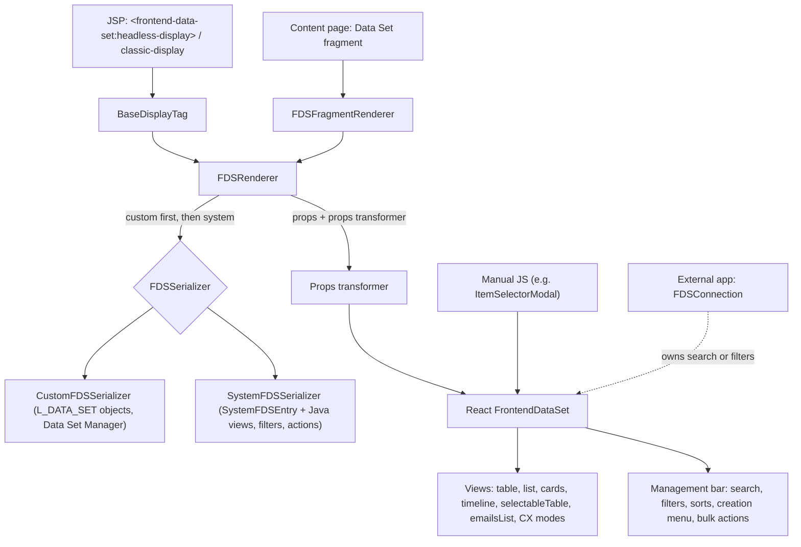

# Frontend Data Set (FDS)

<!-- Sources: written from liferay-portal master code (Nov 2026) and the team's description; no old guideline covered FDS. -->

**Applies when the PR touches:** `modules/apps/frontend-data-set/**` (all modules), `<frontend-data-set:headless-display>` / `<frontend-data-set:classic-display>` in JSPs, imports of `@liferay/frontend-data-set-web` or `frontend-data-set-web` (`FrontendDataSet`, `FDS_EVENT`, `getOrCreateFDSAtom`, renderers, types), classes implementing `SystemFDSEntry`, `FDSView`, `FDSFilter`, `FDSItemsActions`, `FDSBulkActions`, `FDSCreationMenu`, `FDSSorts`, `GroupedFDSFilters`, `FDSDataProvider`, props transformers passed to a data set, the `L_DATA_SET*` object definitions, the FDS fragment, and `@liferay/js-api/data-set/*`.

This folder describes the Frontend Data Set: the component that renders lists of items (tables, lists, cards and other views) with search, filters, sorting, pagination, selection and actions across most of the admin UI, and on pages built by end users. It is written for two audiences: a reviewer (human or AI) checking an FDS pull request, and a developer who needs to understand how FDS works before changing it.

## Start here

- **Reviewing an FDS change?** Read [`review-checklist.md`](review-checklist.md) first, then the aspect files the routing table below sends you to.
- **New to FDS?** Read [`architecture.md`](architecture.md), then [`data-set-kinds.md`](data-set-kinds.md). The rest can be read on demand.

## The big picture

## Which file answers what

| File | Read it for | Route here when the diff touches |
| --- | --- | --- |
| [`review-checklist.md`](review-checklist.md) | The cross-cutting regression matrix: entry points, views, selection, filtering, search, pagination, state, tests to ask for | **Always**, for any FDS change |
| [`architecture.md`](architecture.md) | The layers from the browser down; the React component; the taglib; `FDSRenderer`, serializer choice and prop precedence; headless vs classic display | `FrontendDataSet.tsx`, `FDSRenderer*`, `*FDSSerializer*`, `BaseDisplayTag` and the display tags, the taglib TLD, `FDSDataProvider`, `FDSApplication`, `FDSActionProvider`, `FDSKeywords` |
| [`data-set-kinds.md`](data-set-kinds.md) | Manual JS, `SystemFDSEntry`, old-way Java, custom object-based data sets; the `SystemFDSSerializer.isAvailable()` discrepancy | `SystemFDSEntry` implementations or registry, Java `FDSView`/`FDSFilter`/actions components, taglib attributes on existing usages, direct `<FrontendDataSet>` renders |
| [`importing.md`](importing.md) | Importing a system data set into the Data Set Manager; `DETACHED`, `ITEM_PROXY`, `GROUP_PROXY` | `FDSEntryItemImportPolicy`, `ImportSystemDataSetMVCResourceCommand`, the proxy resolution in `CustomFDSSerializer`, data `id`s of system items, the `target` field of actions |
| [`fragment.md`](fragment.md) | The Data Set fragment, token interpolation, page-dependent resolution | `frontend-data-set-fragment-web/**`, `FDSAPIURLBuilder`, token mappings, `LPD-38564` |
| [`views-and-renderers.md`](views-and-renderers.md) | Built-in views, custom view components, internal cell and section renderers, empty states | `views/**`, `renderers/**`, `getViewComponent`, schemas, `FDSTableSchemaBuilder`/`FDSCardSchemaBuilder`, `FDSView` implementations |
| [`filters-search-sorting.md`](filters-search-sorting.md) | Filter types and OData, search, sorts, pagination, `FDSConnection`, config in URL | `management_bar/controls/filters/**`, search and pagination controls, `utils/filters/**`, `FDSConnection`, `useConfigInURL`, `FDSFilter`, `FDSSorts` |
| [`actions-and-selection.md`](actions-and-selection.md) | Item actions, bulk actions, creation menu, selection and select all | `actions/**`, `utils/actionItems/**`, `BulkActions.tsx`, `CreationMenu.tsx`, selection state, `FDSItemsActions`, `FDSBulkActions`, `FDSCreationMenu` |
| [`props-transformers.md`](props-transformers.md) | The internal props-transformer contract and its use cases; what must not break | Anything a props transformer reads or produces; `IFrontendDataSetProps` and the exported types; `frontend-data-set-sample-web/**/js/*PropsTransformer.ts`; `getPropsTransformer()` |
| [`client-extensions.md`](client-extensions.md) | The third-party contract: CX cell renderers, filters, visualization modes, `@liferay/js-api/data-set` | `views/client_extension/**`, `ClientExtensionFilter.tsx`, `FDSCellRendererCET`, `FDSFilterCET`, `FDSVisualizationModeCET`, `@liferay/js-api` version |
| [`data-set-manager.md`](data-set-manager.md) | Placeholder: the Data Set Manager admin app | `frontend-data-set-admin-web/**`, `L_DATA_SET*` object definitions, upgrades in `frontend-data-set-impl/.../upgrade/` |

Load the README and `review-checklist.md` for every FDS change. Then load each aspect file whose row matches the diff. A refactor of `FrontendDataSet.tsx` itself usually matches most of them.

## Terms

- **Data set**: a named configuration that feeds the React component (views, filters, actions, API URL, …). See [`data-set-kinds.md`](data-set-kinds.md).
- **System data set**: a data set defined in Java through `SystemFDSEntry`. **Custom data set**: one stored as `L_DATA_SET` object entries and managed in the Data Set Manager.
- **View** / **visualization mode**: how items are drawn (table, list, cards, …). Client extensions can add visualization modes.
- **Renderer**: draws one table cell or list section. Internal renderers are portal code; client extension renderers come from third parties.
- **Props transformer**: a JS module that receives the component props and returns the final ones. Internal contract. See [`props-transformers.md`](props-transformers.md).
- **Import policy**: how an imported copy of a system data set keeps following code (`DETACHED`, `ITEM_PROXY`, `GROUP_PROXY`). See [`importing.md`](importing.md).
- **Classic display**: the taglib variant fed by a server-side `FDSDataProvider` instead of a REST endpoint.
- **Old-way data set**: Java views, filters and actions with no `SystemFDSEntry`; configured through taglib attributes.

## Open flags and gaps

Every `REVIEW-FLAG` stays next to the claim it questions. The open ones in this folder:

- [`data-set-kinds.md`](data-set-kinds.md): no ticket yet for the `SystemFDSSerializer.isAvailable()` discrepancy.
- [`props-transformers.md`](props-transformers.md): no Playwright spec covers the custom view component (`CarouselView`) or a click on the empty sample's creation menu item.
- [`architecture.md`](architecture.md): context contributors, `FDSAPIURLResolver`, side and info panels, inline editing and adding, nested items and `FDS_EVENT` are not described.
- [`views-and-renderers.md`](views-and-renderers.md): the schema builders and each view's specific behavior are not described.
- [`filters-search-sorting.md`](filters-search-sorting.md): snapshots and their sharing are not described.
- [`data-set-manager.md`](data-set-manager.md): the whole Data Set Manager is still to be written.
